# Real-Time Visual Inspection Line Review Queue

A high-performance, real-time inspection queue web application engineered for industrial manufacturing quality control. Built with **FastAPI**, **PostgreSQL 16**, native **WebSockets**, and **Vanilla HTML5/CSS3/JavaScript**, packaged for instant deployment via **Docker Compose**.

Designed to handle continuous streams of component inspections, sudden high-volume bursts, concurrent human reviewers, and bounded walkaway recovery with zero frontend polling.

---

## 1. System Overview & Core Invariants

The application manages the human review stage of an automated visual inspection line. Items are generated with varying priority levels (Critical Defect 9–10, High Severity 6–8, Routine Inspection 1–5), queued in PostgreSQL, and distributed across 6 concurrent human inspector workstations.

### Core Architectural Invariants
1. **Handout Atomicity (`SELECT ... FOR UPDATE SKIP LOCKED`):** Reviewers concurrently claim items with zero locking contention, zero double-claims, and zero blocking cascades. Candidate seek, row locking, state transition to `CLAIMED`, lease initialization, and audit event creation execute in a single atomic SQL transaction.
2. **Zero Duplicate Claims:** Two concurrent reviewers can never receive the same inspection item under any load or burst condition.
3. **One Active Item Per Reviewer:** Enforced via a database partial unique index (`CREATE UNIQUE INDEX idx_one_active_claim_per_reviewer ON inspection_items (claimed_by) WHERE status = 'CLAIMED'`). Multiple simultaneous claim requests from the same reviewer idempotently return their currently active item.
4. **Bounded Walkaway Recovery (< 9.0s Target):** If a reviewer steps away, closes their browser, or loses network connectivity, their lease expires and an asynchronous background sweeper automatically reclaims the item back to `PENDING`. Configured with an 8.0s lease duration and a 1.0s sweeper cadence, yielding an observed recovery of **8.50 seconds** in browser E2E testing (providing 0.5s margin under active network/browser loop) and **8.06 seconds** in database sweeper audits.
5. **Zero Frontend Polling:** All queue telemetry, backlog counts, active reviewer rosters, next-up previews, and lease updates are pushed immediately over persistent WebSockets with monotonic sequence ordering (`seq`) and UTC timestamps.
6. **Single-Command Startup:** Starts entirely via `docker compose up --build`.

---

## 2. Architecture Diagram

```mermaid
flowchart TD
    subgraph Ingestion ["Ingestion & Synthesis Layer"]
        GEN["Load Generator\n(Steady 5/s | Burst 250 in <10s)"]
    end

    subgraph Storage ["PostgreSQL 16 (ACID Storage)"]
        ITEMS[("inspection_items\n(Partial Index on PENDING)")]
        AUDIT[("audit_events\n(Immutable Event Log)")]
        SWEEPER_DB["Lease Sweeper\n(Every 1.0s, SKIP LOCKED)"]
    end

    subgraph Backend ["FastAPI Application"]
        ENGINE["Queue Engine\n(Atomic CTE Handout)"]
        SWEEPER["LeaseSweeper Service\n(Bounded Recovery <9s)"]
        WS_MGR["ConnectionManager\n(Monotonic Seq Push Layer)"]
    end

    subgraph Clients ["6 Reviewer Workstations & Monitors"]
        R1["Workstation 1\n(/?reviewer=reviewer_1)"]
        R2["Workstation 2\n(/?reviewer=reviewer_2)"]
        R3["Workstation 3\n(/?reviewer=reviewer_3)"]
        R4["Workstation 4\n(/?reviewer=reviewer_4)"]
        R5["Workstation 5\n(/?reviewer=reviewer_5)"]
        R6["Workstation 6\n(/?reviewer=reviewer_6)"]
        GOD["6-Screen Grid View\n('God Mode' Overview)"]
    end

    GEN -->|Bulk Async INSERT| ITEMS
    GEN -->|Bulk Audit Log| AUDIT
    GEN -->|Arrival Event| WS_MGR

    R1 & R2 & R3 & R4 & R5 & R6 -->|Atomic Claim / Decide / Release| ENGINE
    R1 & R2 & R3 & R4 & R5 & R6 <-->|WebSocket: 2-Way Heartbeats & Push| WS_MGR
    GOD <-->|WebSocket: Real-time Telemetry| WS_MGR

    ENGINE <-->|SELECT FOR UPDATE SKIP LOCKED| ITEMS
    ENGINE -->|Append Event| AUDIT
    ENGINE -->|State Change Event| WS_MGR

    SWEEPER <-->|Reclaim Expired Leases| ITEMS
    SWEEPER -->|LEASE_EXPIRED Audit| AUDIT
    SWEEPER -->|Push LEASE_LOST & Refresh| WS_MGR
```



---

## 3. How to Run Locally

### Option A: Docker Compose (Recommended)
This runs the complete system (PostgreSQL 16 Alpine + FastAPI Application) with healthchecks and automatic schema migration.

```bash
# 1. Clone or navigate to the project directory
cd /path/to/realtime-review-queue

# 2. Build and launch all containers
docker compose up --build
```

To stop the containers:
```bash
docker compose down
```

### Option B: Native Local Setup (Python + PostgreSQL)
If running directly on a host machine without Docker:

```bash
# 1. Ensure PostgreSQL is running and create the database
createdb review_queue

# 2. Create and activate a Python virtual environment
python3 -m venv .venv
source .venv/bin/activate

# 3. Install dependencies
pip install -r requirements.txt

# 4. Set environment variables (adjust credentials if needed)
export POSTGRES_HOST=localhost
export POSTGRES_PORT=5432
export POSTGRES_USER=postgres
export POSTGRES_PASSWORD=postgres
export POSTGRES_DB=review_queue

# 5. Launch FastAPI with Uvicorn
uvicorn app.main:app --host 0.0.0.0 --port 8000
```

---

## 4. How to Test and Interact with the Review System

Once the application is running, open your web browser:

### Step 1: Open Reviewer Screens
- **6-Reviewer Grid Overview ("God Mode"):** Open [http://localhost:8000/](http://localhost:8000/).
  - This overview displays all 6 workstations simultaneously, live backlog counters, active reviewer tags, defect category breakdowns, and generator controls.
- **Dedicated Workstation Screens:** Open two or more independent reviewer tabs side by side:
  - Reviewer 1: [http://localhost:8000/?reviewer=reviewer_1](http://localhost:8000/?reviewer=reviewer_1)
  - Reviewer 2: [http://localhost:8000/?reviewer=reviewer_2](http://localhost:8000/?reviewer=reviewer_2)
  - Reviewer 3: [http://localhost:8000/?reviewer=reviewer_3](http://localhost:8000/?reviewer=reviewer_3)
  - (Reviewers 4 through 6 can be accessed via `reviewer_4`, `reviewer_5`, `reviewer_6` or via the top-bar dropdown).

### Step 2: Ingest Inspection Items
Use the built-in generator panel at the top of the interface:
- **Seed 10 Items:** Instantly injects 10 test parts to test claim and review mechanics.
- **Trigger 250 Burst (<10s):** Injects a flood of 250 items over 8.0 seconds (~31 items/sec) to test high-contention concurrent claiming.
- **Start Steady Flow:** Toggles a continuous background trickle of ~5 items/second.

### Step 3: Test Concurrent Atomic Claiming & Reviews
1. On **Reviewer 1's** screen, click **"CLAIM NEXT ITEM"** (or press `Space`).
2. Simultaneously on **Reviewer 2's** screen, click **"CLAIM NEXT ITEM"** (or press `Space`).
3. Notice:
   - Reviewer 1 and Reviewer 2 receive distinct, non-overlapping parts.
   - The queue counters update instantly on both screens via WebSocket push.
   - The active inspection card displays component name, defect type, bounding dimensions, camera ID, and AI confidence score.
4. Submit an inspection judgement:
   - Click **PASS (Accept)** or press `P`.
   - Click **FAIL (Reject)** or press `F`.
   - Click **Release Back to Queue** or press `R` to voluntarily return the item to `PENDING`.

### Step 4: Test Walkaway Recovery (< 9.0s Bound)
1. On Reviewer 1's screen, claim an item.
2. Click **"Simulate Walkaway (Pause Heartbeats)"**.
3. Watch the visual lease bar count down from 8.0s to 0.0s (automated WebSocket heartbeats are suspended).
4. At ~8.5 seconds:
   - Reviewer 1's desk automatically clears and unlocks back to the empty state with a "Lease Expired" notification.
   - Switch to Reviewer 2's screen and click **"CLAIM NEXT ITEM"**: Reviewer 2 immediately receives the exact item abandoned by Reviewer 1.

### Step 5: Verify Zero Polling
1. Open Browser DevTools (`F12`), switch to the **Network** tab, and filter by `Fetch/XHR`.
2. Notice that **no periodic HTTP polling requests** are sent.
3. Switch filter to `WS` (WebSockets) to view the incoming push frames (`QUEUE_UPDATE`, `CLAIM_RESULT`, `LEASE_LOST`) streaming in real time.

---

## 5. Keyboard Shortcuts

For ergonomic high-speed inspection:
- `Space` or `Enter`: Claim next highest priority item
- `P`: PASS / Accept component
- `F`: FAIL / Reject component
- `R`: Release component back to PENDING queue

---

## 6. Automated Testing & Benchmarks

The automated test suite runs against the real PostgreSQL database with zero mocks.

### Run All 44 Automated Tests
```bash
pytest -v tests/test_phase*.py
```

### Run Playwright Headless Firefox E2E Suite
```bash
pytest -v tests/test_phase7_browser_e2e.py
```

### Run Standalone CLI Stress Benchmark
```bash
python scripts/stress_test.py
```

---

## 7. Measured Performance Benchmarks

All metrics reflect real empirical measurements executed on the benchmark harness:

| Metric | Measured Value | Notes |
|---|---|---|
| **250-Item Burst Ingestion Duration** | **8.57 seconds** (~29.2 items/s) | Meets requirement of $< 10.0$ seconds |
| **6-Reviewer Clearing Throughput** | **29.15 items/sec** (250 items in 8.58s) | Sustained concurrent review under burst |
| **Database Index Scan (`EXPLAIN ANALYZE`)** | **0.398 ms** | Scan time on `idx_inspection_items_pending` |
| **Application Claim Latency (Median p50)** | **3.08 ms** | Full HTTP/WS roundtrip under burst contention |
| **Application Claim Latency (90th percentile p90)** | **3.99 ms** | Full HTTP/WS roundtrip under burst contention |
| **Application Claim Latency (95th percentile p95)** | **4.22 ms** | Full HTTP/WS roundtrip under burst contention |
| **Application Claim Latency (99th percentile p99)** | **4.68 ms** | Full HTTP/WS roundtrip under burst contention |
| **Observed Maximum Claim Latency** | **14.77 ms under tested conditions** | Empirical observation under 250-item contention |
| **Duplicate Assignments** | **0** | Verified across all 250 claims |
| **Dropped / Lost Items** | **0** | All 250 items reached terminal state |
| **Audit Completeness Ratio** | **3.00** (750 events for 250 items) | Exactly 1 event per transition (`CREATED`, `CLAIMED`, `PASSED`/`FAILED`) |
| **Walkaway Recovery (Browser E2E)** | **8.50 seconds** | Verified under tested conditions (0.5s margin relative to 9.0s target) |
| **Walkaway Recovery (Database Sweeper)** | **8.06 seconds** | Measured in PostgreSQL audit logs under tested conditions |

---

## 8. API Reference

### REST Endpoints
| Method | Endpoint | Description |
|---|---|---|
| `GET` | `/health` | Container healthcheck (verifies DB pool connectivity) |
| `POST` | `/api/queue/claim` | Atomically claim next highest priority item (`{"reviewer_id": "reviewer_1"}`) |
| `POST` | `/api/queue/judge` | Submit inspection decision (`{"item_id": "...", "reviewer_id": "...", "decision": "PASS"}`) |
| `POST` | `/api/queue/release` | Voluntarily release item back to PENDING (`{"item_id": "...", "reviewer_id": "..."}`) |
| `POST` | `/api/queue/heartbeat` | Extend lease for active claim (`{"item_id": "...", "reviewer_id": "..."}`) |
| `GET` | `/api/queue/stats` | Telemetry snapshot (pending, claimed, completed counts, active reviewers) |
| `POST` | `/api/generator/burst` | Trigger burst flood (`{"size": 250, "duration": 8.0}`) |
| `POST` | `/api/generator/start` | Start steady trickle generator (~5 items/s) |
| `POST` | `/api/generator/stop` | Stop steady trickle generator |

### WebSocket Channels
- `/ws/reviewer/{reviewer_id}`: Bidirectional reviewer channel supporting instant `CLAIM`, `DECIDE`, `RELEASE`, and `HEARTBEAT` messages, initial state hydration, and targeted `LEASE_LOST` push alerts.
- `/ws/queue`: Read-only broadcast channel for telemetry monitors, supervisor dashboards, and multi-screen synchronization.
